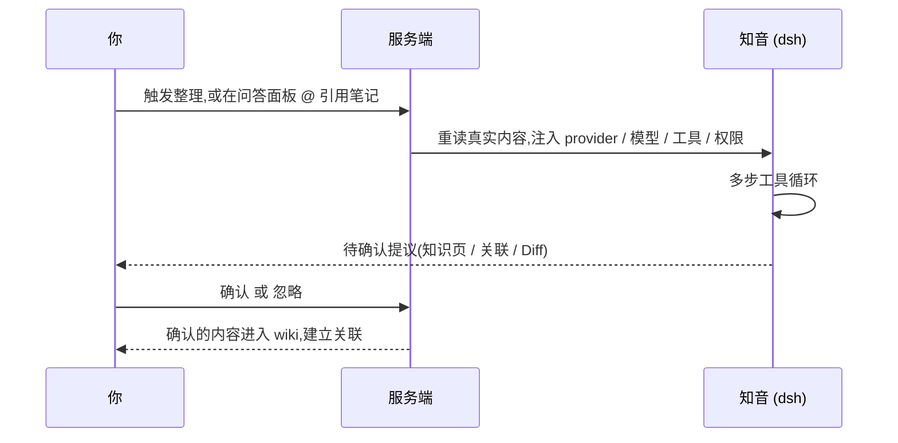

<p align="center">
  
</p>

<p align="center">
  <a href="#认识知音">认识知音</a> ·
  <a href="#先看它如何工作">工作流</a> ·
  <a href="#为什么是和弦">为什么是和弦</a> ·
  <a href="#快速开始">快速开始</a> ·
  <a href="docs/ROADMAP.md">路线图</a>
</p>

# Chordnote · 和弦

**Notes become chords. / 一条笔记是音符,连起来才是和弦。**

Chordnote 是一款面向大学生的生长式 Agent 知识架构师。它把课堂笔记、题目和灵感逐步整理成可复用的知识,再把知识连接成便于回看的个人网络。

它解决的不是"替你写更多笔记",而是让每次学习都留下下一次复习用得上的连接:**AI 负责提出结构,学生负责决定什么值得成为自己的知识。**

## 认识知音

<p align="center">
  
</p>

**知音(Zhiyin)· 抚琴司天监**是 Chordnote 的整理助手。名字取"知音"之意:听懂你的笔记,再替你把散落的音符谱成和弦。

它的分寸只有一条:**只提议,不替你落音。** 它读你的笔记,提出新的知识页、概念和关联,但每一个写入意图都停在"待确认"。点确认才入库,点忽略就丢掉。

### 两种状态

| 状态 | 画面 | 在做什么 |
| --- | --- | --- |
| **工作中 · 拨弦引星** | 星云弥漫,虚线星浮现,灯笼亮起 | 多步工具循环整理笔记,提议概念与关联;有提议等你拍板 |
| **静息中 · 抚琴守望** | 星云收起,灯笼暗下 | 待命。原始记录原样保留,不产生提议,不写入 |

画面里的每个元素对应一个真实状态:

| 画面 | 含义 |
| --- | --- |
| 虚线星 | Draft:待确认的提议 |
| 实心星与金线 | 已确认的 Knowledge 与 Relation |
| 灯笼亮 | 有提议在等你拍板 |
| 三色琴弦 | 蓝、红、金,对应提议、拍板、成和弦 |

### 它能做什么,不会做什么

| 能做 | 不会做 |
| --- | --- |
| 读取笔记,提议新的知识页、概念与关联 | 覆盖或改写 Raw 原始记录 |
| 以 Diff 卡的形式建议改写正文,附在正文底部 | 绕过确认,直接写入 Knowledge |
| 回答问题,`@` 引用已有笔记,服务端重读真实内容后作答 | 在你没点头时,让笔记栏多出一页 |
| 按 LLM Wiki 规范执行:步骤写成可审阅的知识流程 | 把密钥原文发回浏览器 |

### 一次整理发生了什么



### 接入方式

知音由 **dsh** 统一调度。运行时注入 provider、模型、工具与权限,在「设置 → 模型与服务」里选择:

| 方式 | 说明 |
| --- | --- |
| 兼容 API | 选择模型厂商并填写 API Key,也支持自定义兼容接口 |
| 本地 Ollama | 模型跑在本机,无需联网 |
| ACP 外部 Agent | 接入你已安装并登录的外部 Agent,工具边界受限 |

密钥保存在服务端,接口只返回"是否已配置"。ACP 模式需要本机已有兼容的桥接程序,登录由该程序自己完成。

## 先看它如何工作

<p align="center">
  
</p>

当前 Demo 已经跑通这条主链路:

```text
Raw 原始记录 → 知音 Draft → 用户确认 → Knowledge 知识页 → Relation 关联 → Graph 知识网络
```

原始内容保留不被覆盖;AI 的整理结果先停留在 Draft,只有经过确认的内容才会进入知识网络。

**这条链路是有闸门的**:新建笔记只写「原始记录」。知识页只能由「知音提议 → 你确认」产生,所以「笔记」栏里不会凭空多出一页你没点头的东西。

## 为什么是"和弦"

我们借鉴了 LLM Wiki 的知识工作流、Obsidian 的 Live Preview 与双向链接,以及自由白板的空间组织方式,再改造成适合大学生学习的产品机制:

<p align="center">
  
</p>

- **AI 拓扑生长**:dsh 统一调度兼容 API、本地 Ollama 与 ACP 外部 Agent;Agent 提议概念与关联,学生确认后再建立连接。
- **零黑盒法则**:原始 Raw 永远保留;AI 只能生成 Draft,用户确认后才进入 Knowledge。
- **@ 上下文复读**:问答面板直接引用已有笔记,服务端重读真实内容后作答,避免反复复制粘贴。
- **LLM Wiki 规范**:把 Agent 的执行步骤写成可审阅的知识流程,让模型的行为有边界、有迹可循。

这也是 Chordnote 的边界:我们不把 AI 当作替你记忆的黑箱,而把它放在"提议"和"解释"的位置,把最终的知识所有权留给学习者。

## 已经可以体验什么

**写**

- **连续 Markdown 编辑**:一篇笔记只有一个连续文档,标题就是首个一级标题。Live Preview 在光标离开时隐藏语法标记,支持 `[[wikilink]]` 补全、标签、高亮、粗斜体与任务复选框。
- **未整理笔记**:新建内容由服务端写入 `raw/inbox/`,停笔自动保存,不是浏览器里的临时草稿。旧 Raw 路径和导入包继续兼容。
- **自由白板**:浅色点阵画布上双击创建便签,Shift 拖动自由涂画,可拖入或粘贴图片;选中对象后才显示归档与连线手柄,白板按版本保存到 PGlite。

**整理**

- **整理助手**:知音由 dsh 驱动多步工具循环;右侧输入框支持 `@` 引用笔记和切换模型。
- **提议与拍板**:AI 的每个写入意图都落成一条待确认提议。改写正文的建议以 Diff 卡附在正文底部。
- **知识页**:确认后进入 `wiki`;正文上方属性区默认折叠,编辑 `title / source / created / description / tags` 会直接回写同一份 frontmatter。

**连**

- **双向链接**:用户和 Agent 产出的链接共用一条 Markdown 解析管线。未解析链接可显式创建 Raw,入链与出链通过搜索或 Agent 查询。
- **知识网络**:`d3-force` 力学 + Canvas 自绘,可拖动、滚轮缩放、点节点出卡片、双击打开那一页;拖动即固定。

**管**

- **模型与服务**:设置页分为本地模型、模型厂商、自定义模型;支持发现模型、连接测试、服务端密钥保存,以及通过 ACP 接入外部 Agent。
- **统一归档**:Raw、Knowledge 和 Relation 的普通删除都进入 Archive,可恢复;只有在 Archive 内填写理由并确认依赖后才能永久清除。
- **知识包**:一键导出全部数据(JSON 全量快照,可再导入),或导出成 markdown + YAML frontmatter 的 zip,任何读 markdown 的工具都能打开。
- **三套阅读主题**:暗室星图 / 暖纸批注 / 实验工坊;界面声音开关收在设置里。
- **进入体验**:完整落地页;点击「进入编辑室」进入工作台,并记住这次选择。

## 快速开始

```bash
git clone https://github.com/3331060032guoyichen-oss/AI_notes_Chordnote.git
cd AI_notes_Chordnote
pnpm install
pnpm dev
```

打开 <http://localhost:3000>,从左侧「未整理笔记 → 新建笔记」开始。每点一次都会立刻建立一条本机持久化的 Raw;未改名时依次为「未命名1、未命名2…」,随后可直接在文档一级标题修改。左树顺序为 Raw、Wiki、未整理笔记、Schema、Readme,设置入口位于最左侧 Ribbon 底部。

**零配置**:知识库就在本机。PGlite(编译成 WASM 的 PostgreSQL,跑在应用进程里)的数据落在 `data/pglite`,首次启动自动建目录、补齐 `drizzle/` 里的迁移;不需要数据库服务,也不需要联网。

想让知音工作,可在「设置 → 模型与服务」选择厂商并填写 API Key,也可以使用本地 Ollama、自定义兼容接口或 ACP 外部 Agent。环境变量仍可作为部署期覆盖,说明见 [`.env.example`](.env.example) 与 [`docs/DEV_WORKFLOW.md`](docs/DEV_WORKFLOW.md)。

想直接看到有内容的界面:`pnpm seed:demo`(幂等写入一批演示笔记,见 [`AGENTS.md`](AGENTS.md))。

本地知识库的两条边界:

- 同一份数据目录**同一时刻只能有一个进程写**(PGlite 是单写者,别一边跑 `pnpm dev` 一边让另一个进程连同一目录)。
- 数据只在这台机器上,没有多设备与多云同步。**备份 = 拷走 `data/` 目录,或用设置里的「导出知识包」**;换数据目录用环境变量 `PGLITE_DATA_DIR`。

### 桌面端(Windows)

桌面版把 Next.js 与本机 Node 运行时一起打包,安装后双击图标就能用,不需要另开浏览器或终端。

**直接安装**

1. 装好 Node.js 与 pnpm,并准备 Rust(stable)与 Visual Studio C++ 生成工具。
2. 在仓库根目录运行 `pnpm install`,再运行 `pnpm desktop:build`。
3. 安装包生成在 `src-tauri/target/release/bundle/nsis/`,文件名形如 `Chordnote_0.2.0_x64-setup.exe`。
4. 双击安装,然后从开始菜单启动 Chordnote。

首次启动时,应用会在本机 `127.0.0.1:3210` 拉起内置服务,并轮询 `/api/health`;30 秒内没通过就弹窗提示。**3210 端口被别的程序占用时无法启动**,先关掉占用者再试。Windows 10/11 一般已带 WebView2;缺失时安装程序会联网下载 bootstrapper。

**开发模式**

```bash
pnpm desktop:dev   # Tauri 开发窗 + Next.js dev server(127.0.0.1:3210)
```

**数据、配置与退出**

安装版的数据不在仓库的 `data/`,而在 `%LOCALAPPDATA%\Chordnote\`:知识库是 `db\`,模型配置是 `settings.json`,启动日志是 `logs\desktop.log`。网页版与桌面版的数据互不影响。

AI 密钥在应用内「设置 → 模型与服务」里填,保存在上面那个 `settings.json`;接口只返回是否已配置,不会把密钥原文发回浏览器。备份仍然是导出知识包,或直接拷走 `%LOCALAPPDATA%\Chordnote\db`。

## 当前边界与下一步

这是一个 **2026 校赛 Demo**。已经有真实代码的闭环优先于概念展示,当前边界是:

- OCR 转 Markdown、网页剪切、多设备同步仍未实现。
- ACP 已完成协议桥、受限工具边界与本地 fixture 验证;真实 Codex / Claude Code 等外部程序需要用户自己的兼容桥接命令与账号,仓库不携带这些凭据。
- **登录与多用户**:当前是演示期隐式单用户(`DEFAULT_OWNER_ID`),服务层的归属过滤已按用户写好,换实现即可。

完整的目标、现状和差距对照见 [`docs/ROADMAP.md`](docs/ROADMAP.md)。

## 技术栈与项目结构

Next.js 15(App Router) · React 19 · TypeScript · pnpm · CodeMirror 6 · dsh / ACP · 手写 CSS · Drizzle ORM + PGlite(本地嵌入式 PostgreSQL) · Three.js 0.186.0(首屏) · d3-force(图谱力学) · tsParticles(背景星尘) · Tauri 2(Windows 桌面宿主)

```text
app/          Next.js 页面与 API 路由(含 export / import / proposals / agent)
components/   连续 Markdown 编辑器、自由白板、工作区外壳、知识图谱、设置与界面音效
lib/          文档管线、服务层、dsh/ACP Agent 运行时、Provider 边界与知识包
types/        TypeScript 类型
seed/         演示数据(pnpm seed:demo)
scripts/      构建、桌面打包、回归与数据脚本
src-tauri/    Windows 桌面宿主(Tauri 2)
docs/         产品、数据、设计与开发文档
```

开发约定与分支说明见 [`AGENTS.md`](AGENTS.md) 和 [`docs/`](docs/)。

常用验证命令:

```bash
pnpm lint
pnpm test          # HTTP 回归
pnpm test:unit     # Provider / 配置离线单测
pnpm verify:db     # 内存库迁移、约束、外键与归属隔离
pnpm build
```

本轮文档编辑器、Agent、布局、归档与白板改造的逐项验收见 [`docs/reports/2026-10-notes-rebuild.md`](docs/reports/2026-10-notes-rebuild.md)。

## 许可证

本项目采用 [MIT License](LICENSE)。src="./assets/readme/hero.svg" width="100%" alt="Chordnote 和弦：一条笔记是音符，连起来才是和弦" />
</p>

<p align="center">
  <a href="#快速开始">快速开始</a> ·
  <a href="#第一次使用做这三步">第一次使用</a> ·
  <a href="#三档-agent-权限">Agent 权限</a> ·
  <a href="#目录怎么用">目录怎么用</a> ·
  <a href="docs/ROADMAP.md">路线图</a>
</p>

# Chordnote · 和弦

**Notes become chords. / 一条笔记是音符，连起来才是和弦。**

Chordnote 是面向大学生的本地 AI 知识工作台。课堂笔记、阅读摘录、题目和灵感先保存为原始记录，再由 Agent 协助整理成知识页，用链接与图谱连接起来。

**先保留原话，再整理知识。** 默认由你确认每项变更；需要连续处理时，也可以授权 Agent 在本轮任务内直接执行。原始资料始终保留，AI 不改写 Raw 正文。

## 快速开始

### 从源码运行

准备好 Node.js 和 pnpm，包管理器版本以 `package.json` 为准。

```bash
git clone https://github.com/3331060032guoyichen-oss/awesome_notes_agent_Chordnote.git
cd awesome_notes_agent_Chordnote
pnpm install
pnpm dev
```

打开 [本机工作台](http://localhost:3000)，从落地页进入编辑室。页面刷新后会再次从落地页开始，已保存的笔记仍然保留。

如果下载的是 Releases 中的**源码压缩包**，解压后在项目目录执行 `pnpm install` 和 `pnpm dev` 即可。源码压缩包通常不含 Git 历史；需要拉取更新、提交修改时，使用 Git clone 得到的仓库。

笔记、知识库、图谱和白板可在没有 AI 凭据时使用。需要 Agent 时，打开 **Settings → 模型与服务**，选择模型并完成连接测试：

| 接入方式 | 需要准备什么 |
| --- | --- |
| 模型厂商 / 自定义兼容 API | 服务地址、模型名和 API Key |
| 本地 Ollama | 已启动的本机模型服务和已安装的模型 |
| ACP 外部 Agent | 本机已安装、配置并登录的兼容桥接程序 |

模型配置可在界面中保存，也可通过环境变量覆盖，见 [`.env.example`](.env.example)。API Key 仅保存在服务端，接口只返回是否已配置。

### Windows 桌面版

已有 Windows 安装包时，运行安装程序并启动 Chordnote；无需另开终端运行开发服务器。

从源码**构建安装包**需要 Node.js、pnpm、Rust stable 和 Visual Studio C++ 生成工具：

```bash
pnpm install
pnpm desktop:build
```

NSIS 安装包输出到 `src-tauri/target/release/bundle/nsis/`。开发桌面窗口使用 `pnpm desktop:dev`。

桌面版在本机 `127.0.0.1:3210` 启动内置服务，该端口需要可用。Windows 缺少 WebView2 时，安装程序可能需要联网补齐运行环境。

## 第一次使用，做这三步

1. **记下一条原始笔记。** 展开“未整理笔记”，点击“＋ 新建笔记”。系统立即保存一条未命名记录；第一行就是标题，下面写正文，内容自动保存。
2. **让知音整理。** 打开右侧 Agent，输入 `@` 选择这条笔记，再发送：“请整理这条笔记，提炼要点，并查找与已有知识的联系。”
3. **查看并收录。** 默认“可提议”模式会打开整理稿。检查正文与来源分类，点击“确认并收录”；其他更新和关联建议在右侧逐项确认。

收录后，整理出的知识页进入 **Wiki**，原始来源按类别进入 **Raw**，并从“未整理笔记”中移出。

<p align="center">
  
</p>

默认工作流：

```text
未整理笔记 → Raw 原始记录 → Agent 整理稿 → 用户确认 → Wiki 知识页 → 关联与图谱
```

“完全允许”模式由本轮授权代替逐项确认，仍经过服务端的校验、版本检查和审计。Agent 不会因为切换权限而自动应用旧会话中的待确认提议。

## 认识知音

**知音（Zhiyin）· 抚琴司天监**是 Chordnote 的知识整理助手。它由 dsh 运行时调度，读取相关资料、查找已有知识，再整理内容或回答问题。

| 状态 | 表现 |
| --- | --- |
| 静息中 · 抚琴守望 | 等待你的指令；不会在后台自行改动知识库 |
| 工作中 · 拨弦引星 | 执行本轮检索、阅读与整理，结果和操作记录显示在对话中 |

每轮执行会加载内置工作手册、当前 Schema、目录与整理状态。对话历史提供讨论背景，当前服务端数据决定笔记名称、分类和是否已经整理。

### 三档 Agent 权限

在右侧输入框下方的“＋”菜单切换权限，默认选择“可提议”。

| 权限 | 允许的操作 | 变更怎样生效 |
| --- | --- | --- |
| **只读** | 检索、阅读、回答和分析 | 不创建草稿或提议，不修改内容 |
| **可提议** | 提出整理稿、笔记改写、关联与用户偏好建议 | 沿用逐项确认流程，你确认后才应用 |
| **完全允许** | 本轮任务内收录知识页、更新内容、建立关联、调整分类和归档 | 直接执行本轮产生的变更，保留版本检查、修订和审计 |

三档权限都保护 Raw 原文，不开放任意 Shell、原生文件或数据库工具。Schema 可以改变工作方式，实际工具权限由宿主执行。

点“新会话”会结束当前会话并清空对话上下文、运行轨迹与本轮展示卡片；已经保存的笔记与仍待确认的提议会保留。连续提问时，消息区会定位到当前问题，方便从问题开始阅读新回答。

### 可以直接这样说

**整理资料**

> 请整理 @课堂笔记，保留原始来源，优先补充已有知识，避免重复建页。

**比较与查询**

> 对比 @笔记甲 和 @笔记乙，说明相同点与差异，并引用依据。

> 检索已有笔记回答这个问题；没有依据的部分请明确说明。

**检查知识库**

> 检查这些页面的断链和重复内容，先给我建议。

单纯提问不自动保存成知识页。知识库没有依据时，Agent 应明确说明；需要沉淀的内容仍须有 Raw 来源。

## 目录怎么用

左侧顺序固定为 **Raw → Wiki → 未整理笔记 → Schema → Readme**。

| 入口 | 放什么 |
| --- | --- |
| **未整理笔记** | 新想法、摘录与待整理资料；新建时不必先决定分类 |
| **Raw** | 已整理知识对应的原始来源，按 articles / papers / books / media / data 分类 |
| **Wiki** | 概念、实体、来源摘要、综合分析与问题探索等知识页 |
| **Schema** | Agent 的整理规则、写作格式与用户偏好，保存后下一轮生效 |
| **Readme** | 应用内的操作指南 |

Raw 中不设置 `index` 或收件箱子目录。`index` 专属 Wiki，表示按类别组织的知识内容索引；当前索引由知识列表与图谱动态提供，不另生成一个实体 `index.md`。

当前 Wiki 分类沿用 `index / entitles / concept / sources / synthesis / questions / overview`。已有知识路径兼容旧的 `wilki/` 前缀，旧来源路径也继续兼容。

### 写笔记与建立链接

编辑器采用连续 Markdown 文档，首个一级标题就是笔记名称。Live Preview 在光标离开时隐藏语法，进入对应文字即可编辑。

- 输入 `[[` 从补全列表中选择笔记。
- `[[笔记名称]]` 链接到一篇笔记；`[[实际路径|显示名称]]` 自定义显示文字。
- Raw 和 Wiki 可以同名：正文中的短名称链接优先匹配同层笔记，跨层引用用完整路径。
- Agent 回复中的引用显示为笔记名称，点击打开实际笔记；不把底层文件名或生成 ID 当作显示名。
- 未解析链接由用户显式创建 Raw。正文互相引用与图谱正式关联分别维护；正式关联须单独建立。
- 支持标题、标签、高亮、粗斜体、任务复选框和可开关的 LaTeX 公式预览。
- PDF 附件在浏览器原生查看器中打开或嵌入，具体分页布局由浏览器提供；HTML 附件显示名称链接，在浏览器打开。

通过查找和 Agent 查询入链、出链与相关笔记。图谱使用 d3-force 计算、Canvas 绘制，支持拖动、缩放和打开知识页。

### 使用自由白板

点击最左侧的白板图标：

- 双击空白处写便签，按 **N** 新建便签。
- 按住 **Shift** 拖动进行自由绘画。
- 拖入或粘贴图片，拖动卡片调整位置。
- 选中卡片或图片后显示连线手柄与“删除”操作。
- 删除会移除白板对象及其相连线，不删除它引用的笔记；画板不再提供归档恢复面板。

白板自动保存并进行版本检查。笔记的归档与白板对象的直接删除是两种操作。

## 数据、备份与恢复

笔记数据保存在本机的 PGlite 中，无需另装数据库服务。使用云端模型时，当前任务需要的材料会发送给所选模型服务；选择本地模型可在本机处理这些内容。

| 运行方式 | 知识库 | 模型配置 |
| --- | --- | --- |
| 源码网页版 | `data/pglite/` | `data/settings.json` |
| Windows 安装版 | `%LOCALAPPDATA%\Chordnote\db\` | `%LOCALAPPDATA%\Chordnote\settings.json` |

- **归档恢复：** Raw、Knowledge 和 Relation 的普通移除优先归档，在 Settings → Archive 中恢复。永久清除需要填写理由并确认依赖。
- **导出知识包：** 可导出 JSON 快照并重新导入，或导出 Markdown + YAML frontmatter 的 ZIP。
- **完整备份：** 关闭应用后复制相应数据目录，同时保留模型配置和自定义 Schema。
- **单写者：** 同一数据目录同一时刻只运行一个写入进程。开发服务器与桌面版使用不同数据目录。
- **本机数据：** 尚无多设备自动同步。可通过知识包在应用间迁移，Markdown 可用其他笔记工具阅读。

设置中的主题提供暗室星图、暖纸批注与实验工坊；声音开关位于 Settings → Voice，公式显示可在设置中切换。

## 开发与验证

Next.js 15 / React 19 / TypeScript / CodeMirror 6 / dsh 与 ACP / 手写 CSS / Drizzle ORM + PGlite / d3-force + Canvas / Tauri 2。

Three.js 仅用于落地页粒子场；知识图谱使用 Canvas。新增依赖登记在 [第三方依赖](docs/THIRD_PARTY.md)。

```text
app/          单页工作区、样式与本机 API
components/   文档编辑器、Agent 对话、图谱、白板、设置与使用指南
lib/          Markdown、服务层、存储、Provider 与 Agent 运行时
src-tauri/    Windows 桌面宿主
scripts/      验证、演示数据与桌面打包
seed/         可选的演示数据
docs/         产品、设计、数据与开发文档
```

```bash
pnpm lint
pnpm exec tsc --noEmit
pnpm test:unit
pnpm test:agent
pnpm test:vault
pnpm test
pnpm verify:db
```

生产构建使用 `pnpm build`，不要与 `pnpm dev` 同时运行，它们共享 `.next/`。演示数据可在服务启动后用 `pnpm seed:demo` 写入；重置数据参见 [AGENTS.md](AGENTS.md)，不把本机 `data/`、密钥或构建缓存提交到 Git。

## 当前边界

本项目仍处于 Demo 迭代阶段：

- OCR 转 Markdown、网页剪切和多设备同步尚未实现。
- ACP 协议桥与受限工具链已验证，真实外部 Agent 仍需使用者准备兼容程序与登录配置。
- 当前为演示期隐式单用户；没有账号登录界面。
- 模型判断的矛盾、过时结论与缺失概念仍需人工判断。不要把建议当成已核实事实。

继续了解：[路线图](docs/ROADMAP.md) · [开发流程](docs/DEV_WORKFLOW.md) · [数据模型](docs/DATA_MODEL.md) · [Agent 视觉规范](docs/AGENT_VISUAL_SPEC.md)。

## 许可证

[MIT License](LICENSE)。

