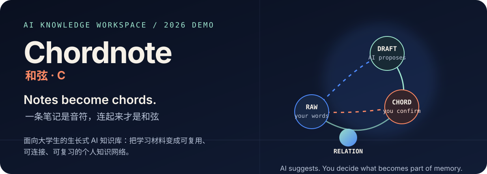
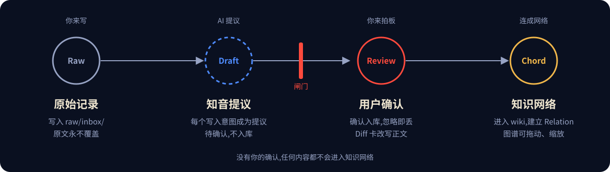
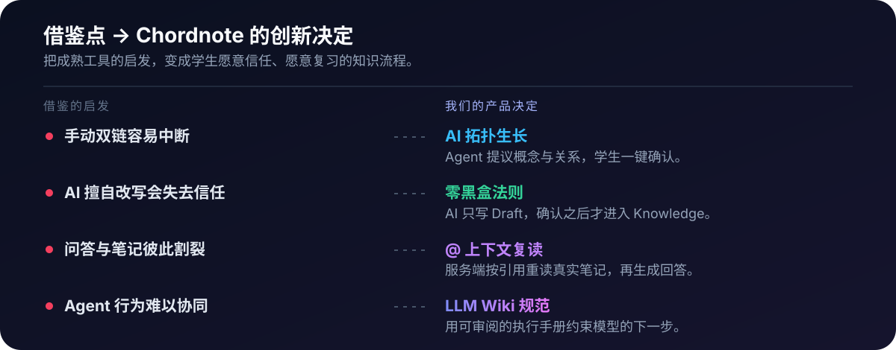

<p align="center">
  
</p>

<p align="center">
  <a href="#快速开始">快速开始</a> ·
  <a href="#为什么是和弦">为什么是和弦</a> ·
  <a href="docs/ROADMAP.md">路线图</a>
</p>

# Chordnote · 和弦

**Notes become chords. / 一条笔记是音符，连起来才是和弦。**

Chordnote 是一款面向大学生的生长式 AI 笔记软件。它把课堂笔记、题目和灵感逐步整理成可复用的知识，再把知识连接成便于回看的个人网络。

它解决的不是“替你写更多笔记”，而是让每次学习都留下下一次复习用得上的连接：**AI 负责提出结构，学生负责决定什么值得成为自己的知识。**

## 先看它如何工作

<p align="center">
  
</p>

当前 Demo 已经跑通这条主链路：

```text
Raw 原始笔记 → AI 整理 Draft → 用户审阅确认 → Knowledge → Relation → Graph API
```

原始内容保留不被覆盖；AI 的整理结果先停留在 Draft，只有经过确认的内容才会进入知识网络。

## 为什么是“和弦”

我们借鉴了 LLM Wiki 的 Agent 执行手册、Obsidian 的反向链接与知识图谱，但把它们改造成适合大学生学习的产品机制：

<p align="center">
  
</p>

- **AI 拓扑生长**：Agent 提议概念与关联，学生确认后再建立连接，降低维护双链的门槛。
- **零黑盒法则**：原始 Raw 永远保留；AI 只能生成 Draft，用户确认后才进入 Knowledge。
- **@ 上下文复读**：问答面板直接引用已有笔记，服务端重读真实内容后作答，避免反复复制粘贴。
- **LLM Wiki 规范**：把 Agent 的执行步骤写成可审阅的知识流程，让模型的行为有边界、有迹可循。

这也是 Chordnote 的边界：我们不把 AI 当作替你记忆的黑箱，而把它放在“提议”和“解释”的位置，把最终的知识所有权留给学习者。

## 已经可以体验什么

- **Raw 原始笔记**：新建、列表、删除，并由服务端校验输入。
- **AI 整理**：调用 DeepSeek 生成结构化 Draft，不覆盖原始内容。
- **审阅入库**：Draft 可逐项编辑；确认后才写入 Knowledge，重复确认不会产生重复记录。
- **Knowledge 知识页**：标题、摘要、正文、概念、关键词，支持内联编辑。
- **关系建议**：AI 提出关联，用户勾选后保存；服务端校验节点存在、拒绝自连接并去重。
- **引用式问答**：在右侧面板用 `@` 提及已有笔记，服务端重新读取真实内容后作答。
- **工作台**：Raw / Knowledge 文件树与标签页协同浏览。
- **进入体验**：滚轮、触摸、键盘都能揭示欢迎界面；Three.js 水晶场景在 WebGL 不可用时降级为海报图。

## 快速开始

```bash
git clone https://github.com/3331060032guoyichen-oss/ai-notes_demo.git
cd ai-notes_demo
pnpm install
cp .env.example .env.local   # 填入 DEEPSEEK_API_KEY
pnpm dev
```

打开 <http://localhost:3000>，从左侧「新建笔记」开始。没有配置 `DEEPSEEK_API_KEY` 时，除 AI 相关功能外，其余界面仍可使用；环境变量说明见 [`.env.example`](.env.example)。

## 当前边界与下一步

这是一个 **2026 校赛 Demo**。已经有真实代码的闭环优先于概念展示，以下能力仍在规划中：

- Raw 的可编辑修订记录（用户可改，AI 不可改）。
- 出链、正文片段建链接，以及真正的一等反向链接面板。
- 可拖动、缩放、聚焦的知识图谱界面（当前提供 Graph API，UI 还是规则网格卡片）。
- 带工具调用循环的 DeepSeek Agent（当前是单轮 `@` 引用问答）。
- 全文搜索、标签聚合、手动多主题、OCR 转 Markdown、网页剪切。

完整的目标、现状和差距对照见 [`docs/ROADMAP.md`](docs/ROADMAP.md)。

## 技术栈与项目结构

Next.js 15（App Router） · React 19 · TypeScript · pnpm · 手写 CSS · Three.js 0.186.0

```text
app/          Next.js 页面与 API 路由
components/   首屏门禁、Three.js 水晶场景、界面音效
lib/          存储层与 DeepSeek 服务边界
data/         本地开发数据（运行时生成）
public/       首屏与知识关系视觉素材
types/        TypeScript 类型
docs/         产品、数据、设计与开发文档
```

开发约定与分支说明见 [`AGENTS.md`](AGENTS.md) 和 [`docs/`](docs/)。

## 许可证

本项目采用 [MIT License](LICENSE)。
